# RPG (working title)

An old-school, third-person **isometric action RPG / dungeon crawler** that runs
in the browser, with **online multiplayer**. You wake up on the bank of a stream
in an unknown forest with almost nothing: tattered clothes, a crude weapon, a
heel of stale bread and an empty waterskin.

> Status: **groundwork**. The engine, networking, class tree, combat loop and
> the first zone (the valley, levels 1–5, with its first quest) are in place.
> Story, more quests, loot and dungeons come next.

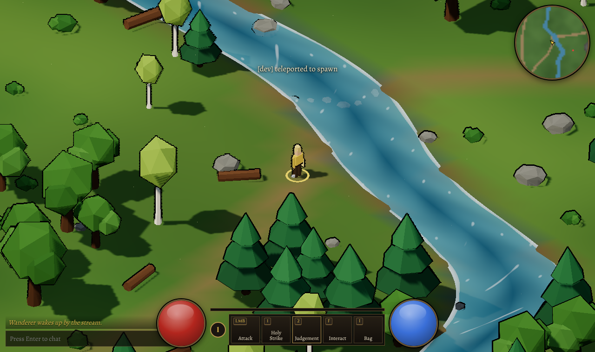

## Tech stack

| Layer | Choice | Licence | Why |
| --- | --- | --- | --- |
| Rendering | [three.js](https://threejs.org) | MIT | Lightweight, mature WebGL renderer. Full control over the classic isometric look. |
| Multiplayer | [Colyseus](https://colyseus.io) | MIT | Authoritative Node.js game server: rooms, matchmaking, delta-compressed state sync, reconnection, Redis scaling. |
| Client build | [Vite](https://vite.dev) + TypeScript | MIT | Fast dev server, simple production build. |
| Art | Procedural low-poly placeholders + optional **CC0** packs (KayKit, Quaternius, Kenney) | CC0 | Runs with zero downloads; real models drop in via a manifest. See [docs/ASSETS.md](docs/ASSETS.md). |

Alternatives that were considered: Babylon.js (heavier, more built in),
PlayCanvas (engine is MIT but the editor is hosted/proprietary), Phaser (2D
only, would mean sprite-based isometric art), Godot web export (large WASM
download, harder to iterate on web networking).

## Play it

A single-player playtest build (the same game rules, running in your
browser, no server) is published at
**<https://claude.ai/artifact/NQf7rgmJppqnD6PubmUHLd>** (private to the owner
until shared). Dev chat commands are on there for testing: press Enter and
type e.g. `/quest silent_village`, `/tp vendor` or `/tp cell`.

Build it yourself with `npm run build:offline` (output in `client/dist-offline/`,
static files you can host anywhere). Multiplayer needs the Node server (see
below; the Dockerfile runs it on any container host).

## Quick start

Requires **Node.js 20+**.

```bash
npm install
npm run dev
```

- Game client: <http://localhost:5173>
- Game server: `ws://localhost:2567` (health check at <http://localhost:2567/health>)

Open the client in two browser windows to see multiplayer. Other people on your
network can join via `http://<your-ip>:5173`.

### Hosting (Proxmox + Cloudflare)

[docs/DEPLOY.md](docs/DEPLOY.md) sets the server up in its own Proxmox LXC
with Docker Compose, published through a Cloudflare Tunnel and behind a
Cloudflare Access login (`deploy/`: `proxmox/create-lxc.sh`, `setup.sh`,
`update.sh`, `docker-compose.yml`).

### Worlds and share codes

Every world instance has a code like `K7Q-M2X`. On the last character-creation
step choose **Start a new world** or **Join a friend's world** and type their
code; the Character panel shows your world's code and a **Copy invite link**
button (`?world=K7Q-M2X` prefills the code). A world stays open for 30
minutes after its last player leaves.

### Production

```bash
npm run build   # builds client/dist
npm start       # one process serves the game client and the multiplayer server on $PORT (default 2567)
```

Or with Docker:

```bash
docker build -t rpg .
docker run -p 2567:2567 rpg
```

### Dev chat commands

When the server is not running with `NODE_ENV=production`, these chat commands help with testing:

| Command | Effect |
| --- | --- |
| `/tp <place>` | Teleport to `spawn`, `pool`, `camp`, `vendor`, `village`, `crypt`, `cell`, `ruins_seal`, `cave_thorns`, `valley_exit`, `signpost`, a shrine (`shrine_<god>`) or a hunting ground (`tusk_meadow`, `greypine_wood`, `webbed_hollow`, `thornbrake`) |
| `/open <gate>` / `/close <gate>` | Open or seal `valley_exit`, `ruins_seal` or `cave_thorns` for everyone |
| `/level <n>` | Set your level |
| `/quest <id\|all\|favor>` | Complete a gate trial (`trial_of_paths`, `trial_of_mastery`), or a god's epic quest (`favor` for your own god's, or `favor_<god>`); completing one makes that god your god |
| `/step [quest]` | Finish the current step of a quest |
| `/quest make_camp` / `/quest silent_village` | Start (if needed) and finish a whole quest |
| `/coins <n>` | Set your coins |
| `/class <id>` | Jump down your tree to a class (sets level 50, completes trials), e.g. `/class dragon_knight` |

### Other scripts

| Command | What it does |
| --- | --- |
| `deploy/update.sh` | On the server: pull, rebuild and restart the game (closes open worlds) |
| `npm run build:offline` | Single-player build (game rules run in the page) into `client/dist-offline/` |
| `npm run balance -w server` | Simulated fights per class and level (difficulty check) |
| `npm run typecheck` | Type-check all three packages |
| `npm test` | Unit tests for shared data/world/movement |
| `npm run docs:classes` | Regenerate [docs/CLASSES.md](docs/CLASSES.md) from the class data |

## Controls

Mouse and keyboard, an **Xbox controller** (the default glyph layout; any
controller using the browser's standard mapping works) and **touch screens**
are all supported. The on-screen prompts switch to whatever you last used.

| Action | Mouse & keyboard | Xbox controller | Touch |
| --- | --- | --- | --- |
| Move | Left click the ground (walks there; hold to steer) / `W A S D` | Left stick (analog: push lightly to walk) | Tap the ground to walk there, or drag on the left half of the screen |
| Attack | Left click an enemy | `A` (auto-targets, hold to keep fighting) | ⚔ button, or tap an enemy |
| Abilities 1-4 | Right click or `1`, then `2` `3` `4` | `X` `Y` `RB` `RT` (aim with right stick, else auto-aim) | Ability buttons (tap to auto-aim, drag to aim) |
| Interact / inspect | `F` | `B` | ✋ button (appears when something is near) |
| Quick-use food / water | `5` / `6` | D-pad ↑ / ↓ | via the pack |
| Character, path & pack (advance here) | `I` | View | 🎒 |
| Map | `M` | Right stick click | 🗺 |
| Zoom | Mouse wheel | D-pad ← / → | Pinch |
| Help | `H` | Menu | ? |

Menus (character creation, pack) are navigable with the D-pad / stick and `A`;
`Menu` starts the game from character creation, `B` closes panels. Controllers
rumble when you take damage, where the browser supports it.

On phones the game runs in landscape or portrait, and can be added to the home
screen to run full-screen (it ships a web app manifest).


## What's in the groundwork

- **Class progression: 4 → 8 → 16 → 32.** Start as a Fighter, Mage, Priest or
  Thief, then choose one of two paths at levels 10, 25 and 50 (25 and 50 need a
  gate trial; choices are permanent). Each base has 5 pure and 3 hybrid end
  classes (hybrids blend a second base; every pair of bases has two). Each
  class teaches one ability, so a level-50 character has four plus a basic
  attack. Full tree: [docs/CLASSES.md](docs/CLASSES.md).
- **Pets and familiars.** Each base has two pet classes on separate lines with
  different creatures, one traditionally good and one evil:

  | Base | Good | Evil |
  |---|---|---|
  | Fighter | Woodsman → **Beastlord** (wolf pup → alpha wolf) | Dark Knight → **Death Knight** (nightmare hound → hellhound) |
  | Mage | Conjurer → **Phoenix Caller** (firebird → phoenix) | Necromancer → **Lich** (skeletal servant → champion) |
  | Priest | Wildcaller → **Archdruid** (sapling → ancient treant) | Shaman → **Witch Doctor** (lesser loa → bound loa) |
  | Thief | Scout → **Falconer** (hawk → war falcon) | Assassin → **Plaguebringer** (plague rat → rat king) |

  The level-25 line brings the young companion; at 50 the pet class grows it
  into something several times stronger, while every other end class gains a
  lesser familiar. Companions follow you, fight your target, defend you and
  return if downed.
- **Party play**: four stranded travellers (a fighter, a mage, a priest and a
  thief) wait at the merchant's camp; ask **one** to adventure with you. From
  level 4, creatures hunt in packs built for two. See
  [docs/VALLEY.md](docs/VALLEY.md#the-stranded-travellers-companions).
- **Character creation** in six steps with a live 3D preview: appearance
  (build, skin, hair, beard, clothes dye; everyone starts in ragged clothes),
  calling (base class), a **first memory** that secretly picks your background
  (revealed through memories at levels 3, 8 and 15), faith (flavour), and
  point-buy attributes. See [docs/CHARACTER_CREATION.md](docs/CHARACTER_CREATION.md).
- **A level 1–5 starting zone** ([docs/VALLEY.md](docs/VALLEY.md)), about
  3 km x 4.5 km (10 minutes across, 15 end to end), streamed in chunks:
  - **Four hunting grounds**: Tusk Meadow (boars, 1–2), Greypine Wood (wolves,
    2–3), Webbed Hollow (spiders, 3–4) and the Thornbrake (thornlings, 4–5).
    Creatures have levels, and wolves, spiders and thornlings inflict
    bleeding, poison and blight.
  - **A shrine to each god.** Your god's shrine calls to you with a pillar of
    light. The first prayer receives your blessing; after that it cures every
    status effect and heals you.
  - **Haskel the Peddler**, stranded by the rockfall at the road out: buys
    your loot, sells rations, healing draughts, throwing knives, arrows,
    books and a map, hands out repeatable odd jobs, and gives a plain weapon
    to anyone who's lost theirs. His quest, *The Silent Village* (8 steps,
    about 20 minutes), sends you into **Ashford**, a village overrun by the
    dead (levels 2–3), to face Old Corwin the gravedigger and the Hollow
    Priest. The reward is your calling's first upper-body armour, and the
    kingdom clears the road out, where the King's soldiers arrest you and
    throw you in a castle dungeon cell far from the valley (only the cell is
    built so far).
  - **Loot, coins and equipment**: creatures drop pelts, hides, meat, silk,
    bones, coins and rusty gear. Equip weapons and armour from your pack
    (armour shows on your character). Food heals over time out of combat,
    draughts heal at once in it, and raw meat cooks at the camp fire.
  - **No map until you find one**: the map fills in as you explore, or buy
    Haskel's.
  - **A campsite** you build in the first quest, *Shelter* (gather firewood
    and river stones, hunt boars for hides, make camp; about ten minutes).
    Resting there heals you, makes you Well Rested (+15% XP) and brings every
    hunting ground back to full strength. You respawn at the camp once it's
    built.
- **The starting valley**: a forested valley (~3 km × 4.5 km) walled in by
  mountains. A waterfall in the north cliffs feeds a pool and a winding stream
  (wading slows you down) that leaves through a gorge in the south. Worn trails
  lead from the clearing where you wake to three places you can't enter yet:
  - **The Narrow Pass** (east): the only way out, buried under a rockslide.
  - **Unknown Ruins** (south-west): a broken colonnade around a stairway sealed by a rune-carved slab.
  - **The Cave Mouth** (north-west): a cave in the cliffs, choked with black thorns.

  Each is a server-side *gate*: sealed for now, with an inspect message, and
  ready for the story to open later (`/open` in dev). Landmarks are announced
  the first time you find them and appear on the minimap.
- **Cel-shaded look**: toon lighting in hard bands and ink outlines from a
  screen-space depth pass.
- **Time-of-day lighting, ready for a day/night cycle**: sun, sky, fog, colour
  grade, your lantern, firefly and landmark glows all come from presets
  (night, dawn, day, dusk) blended by hour in `client/src/scene/Lighting.ts`.
  The game is fixed at mid-morning for now; add `?time=21` to the URL to
  preview night (any hour 0-24 works).
- **Isometric cut-away**: mountains on the camera side of the valley are kept
  low and anything between the camera and your character fades out, so you are
  never hidden.
- **Minimal starting supplies**: class-flavoured crude weapon, tattered clothes,
  stale bread (food) and an empty waterskin you can fill at the stream (`F`) and
  drink to restore your resource.
- **Server-authoritative multiplayer** (up to 16 per world instance): movement,
  combat, abilities, buffs, enemy AI, XP sharing, levelling, death and respawn.
- **Forest creatures**: tusked boars, grey wolves, hollow spiders and
  thornlings that wander, aggro, chase, leash back home and respawn in their
  own hunting grounds.
- **Classic isometric presentation**: orthographic camera, low-poly art,
  see-through foliage around your hero, health/resource orbs, hotbar with
  cooldowns, floating combat text, nameplates, party frames, chat.

| Your camp at night | A shrine calls to its follower |
| --- | --- |
| 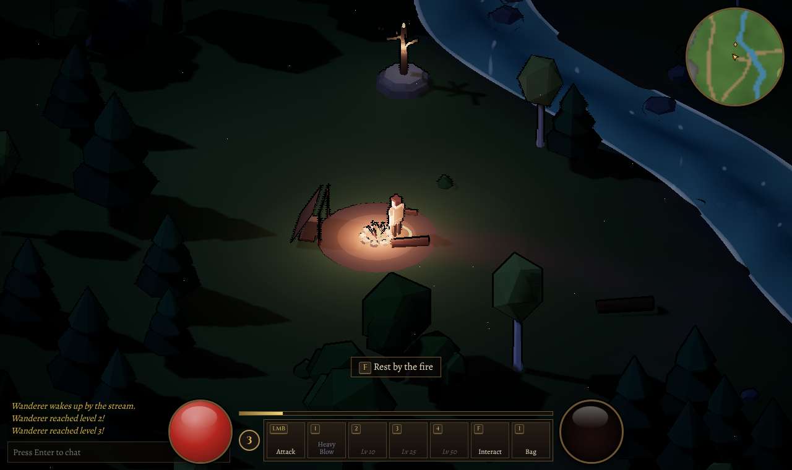 | 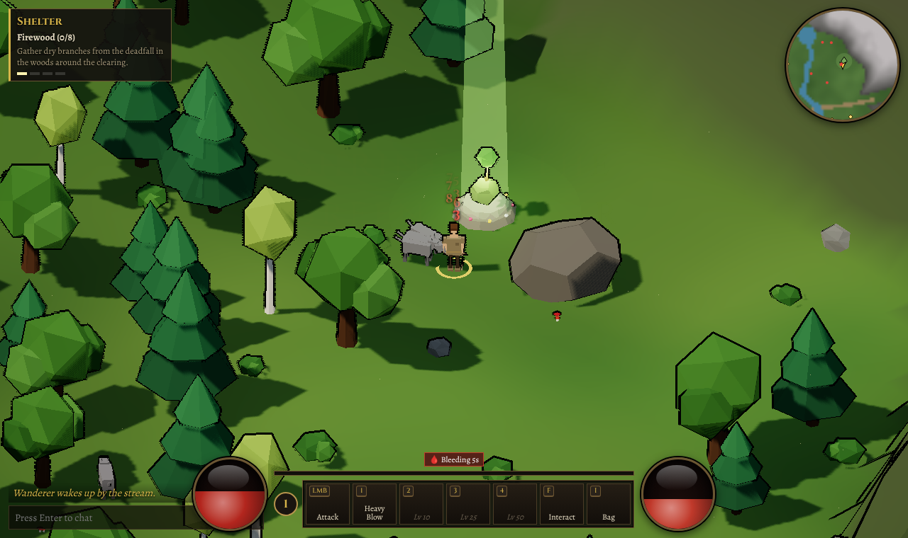 |

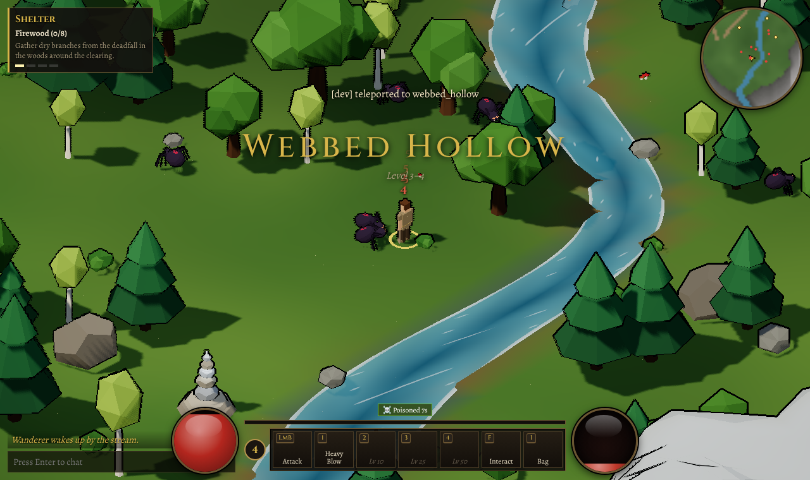

| Haskel the Peddler | Ashford, overrun by the dead |
| --- | --- |
| 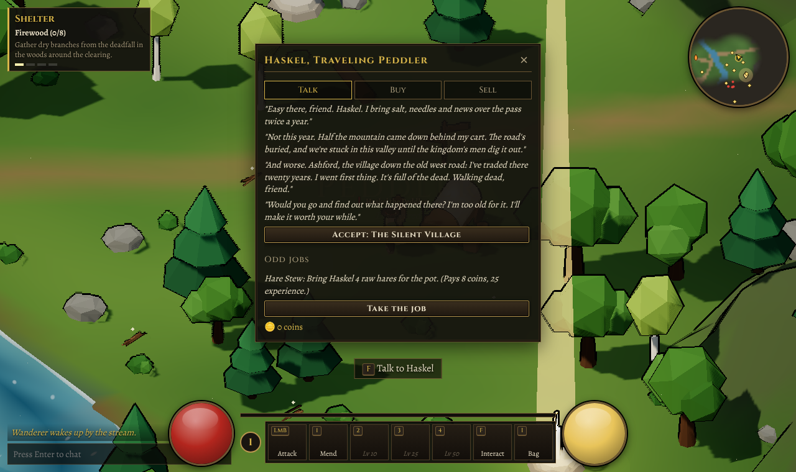 | 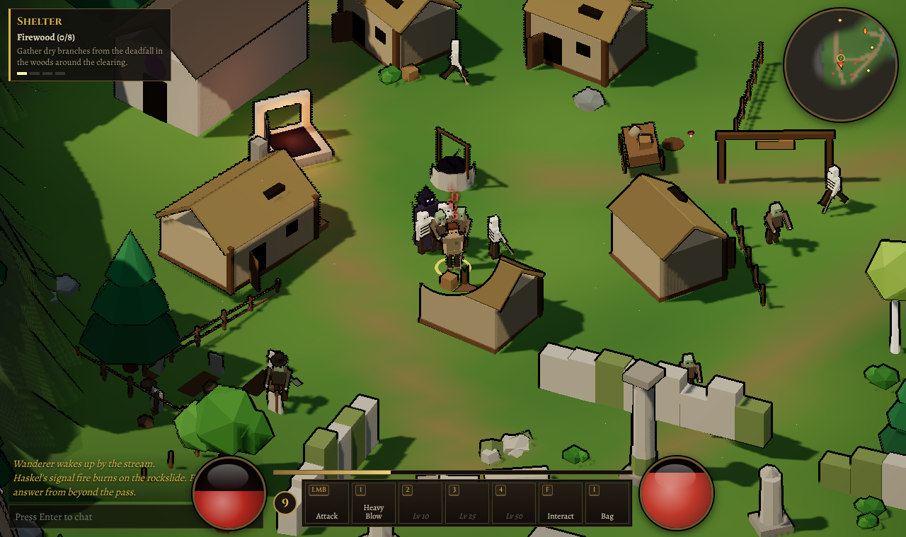 |


| The Cave Mouth | The Narrow Pass |
| --- | --- |
| 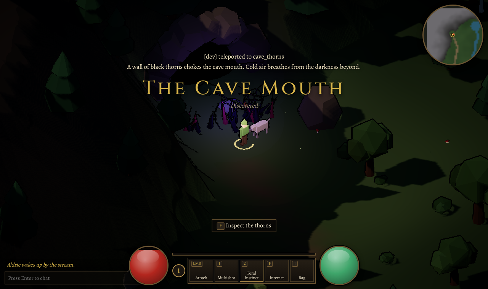 |  |

| Night preview (`?time=21`) | Valley map |
| --- | --- |
| 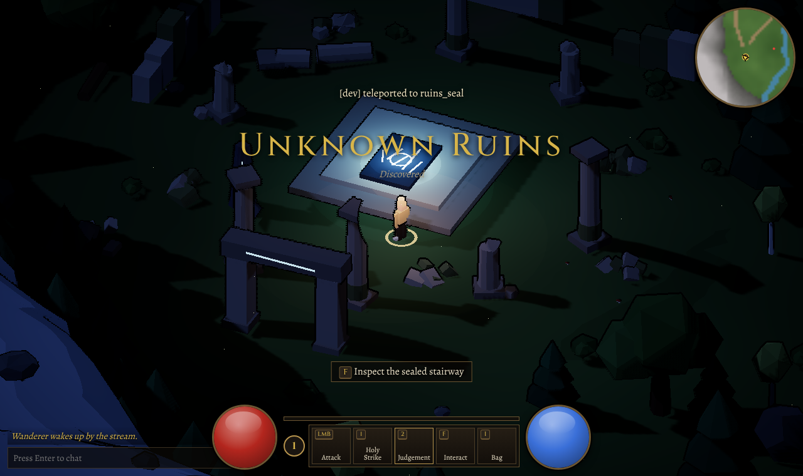 |  |


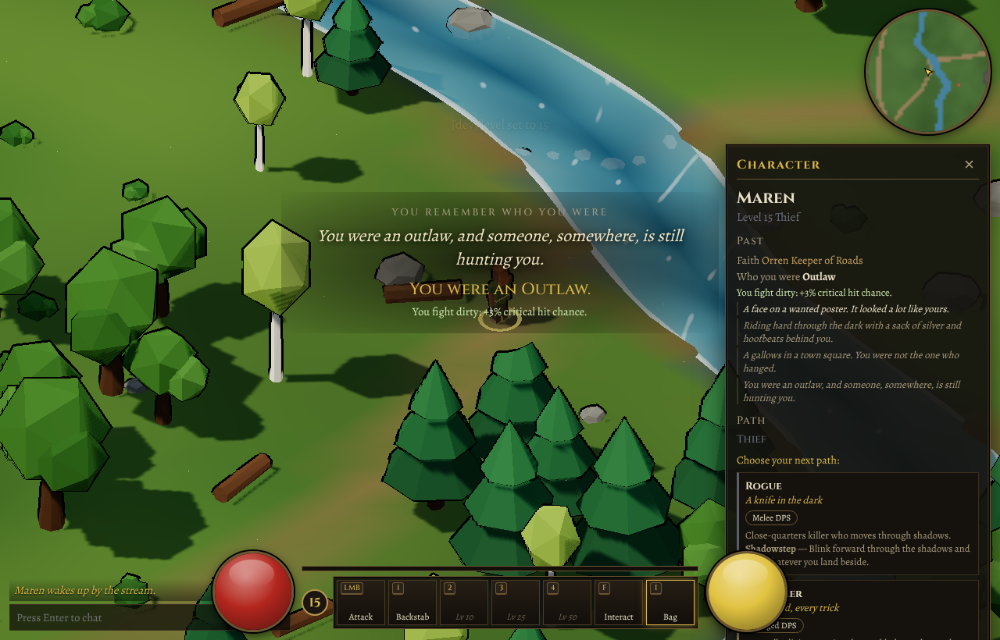

| Choosing a path (Character panel) | The 8 pet classes at 50: Beastlord, Death Knight, Phoenix Caller, Lich, Archdruid, Witch Doctor, Falconer, Plaguebringer |
| --- | --- |
| 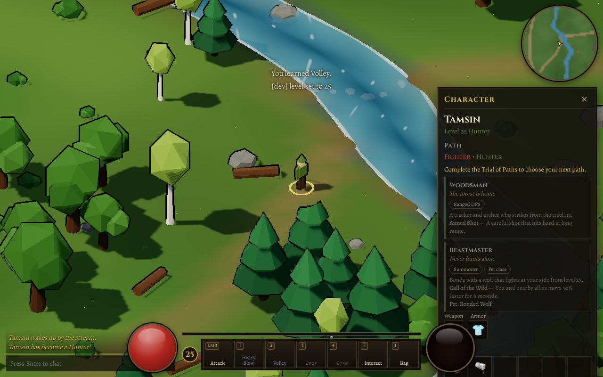 | 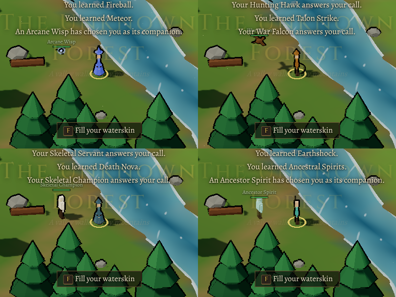 |

## Project layout

```
shared/   game data & rules used by client and server (classes, items, enemies, world gen, movement, protocol)
server/   Colyseus server: ForestRoom (networking) + Game (simulation) + synced schema
client/   Vite + three.js: scene, avatars, effects, input, HUD, character creation
docs/     architecture, class reference, asset sources
```

Read [docs/ARCHITECTURE.md](docs/ARCHITECTURE.md) for how the pieces fit, [docs/VALLEY.md](docs/VALLEY.md) for the starting zone, and [docs/WORLD.md](docs/WORLD.md) for the setting and story outline (spoilers).

## Roadmap

Suggested next steps, roughly in order:

1. **Art pass**: drop in KayKit/Quaternius CC0 packs via the model manifest (manual download for now; see [docs/ASSETS.md](docs/ASSETS.md)).
2. **Persistence**: accounts and saved characters (Colyseus auth + a database such as SQLite/Postgres).
3. **Loot & inventory**: drops, equipment slots, item rarity, vendor.
4. **Abilities 2.0**: more status effects (slow, stun) and player-applied ones, forms (Primalist), taunts; companion commands and abilities.
5. **Gate quests**: the Trial of Paths (25) and Trial of Mastery (50); the lineage system for changing paths.
6. **Dungeons**: instanced rooms generated from KayKit dungeon tiles; parties enter together.
7. **Story & quests**: the amnesia hook, the gods' epic quests, NPCs, the first settlement; opening the valley's gates.
8. **Day/night cycle**: advance the hour from server time (`GameClient.setHour`); night spawns, light radius gameplay.
9. **Audio**: ambience (stream, birds), combat SFX, music.
10. **Ops**: Redis presence for multiple server processes, deployment pipeline.
