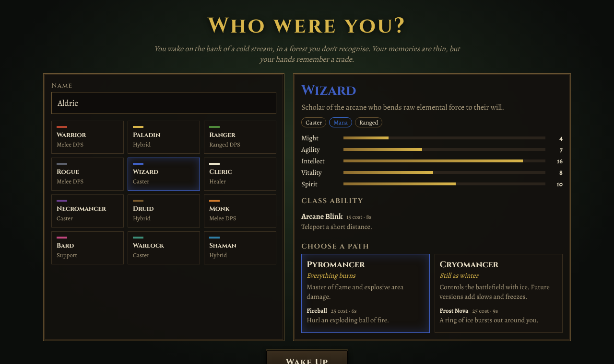

# RPG (working title)

An old-school, third-person **isometric action RPG / dungeon crawler** that runs
in the browser, with **online multiplayer**. You wake up on the bank of a stream
in an unknown forest with almost nothing: tattered clothes, a crude weapon, a
heel of stale bread and an empty waterskin.

> Status: **groundwork**. The engine, networking, 12 classes, combat loop and
> starting forest are in place. Story, quests, loot and dungeons come next.


## Tech stack

| Layer | Choice | Licence | Why |
| --- | --- | --- | --- |
| Rendering | [three.js](https://threejs.org) | MIT | Lightweight, mature WebGL renderer. Full control over the classic isometric look. |
| Multiplayer | [Colyseus](https://colyseus.io) | MIT | Authoritative Node.js game server: rooms, matchmaking, delta-compressed state sync, reconnection, Redis scaling. |
| Client build | [Vite](https://vite.dev) + TypeScript | MIT | Fast dev server, simple production build. |
| Art | Procedural low-poly placeholders + optional **CC0** packs (KayKit, Quaternius, Kenney) | CC0 | Runs with zero downloads; real models drop in via a manifest. See [docs/ASSETS.md](docs/ASSETS.md). |

Alternatives that were considered: Babylon.js (heavier, more built in),
PlayCanvas (engine is MIT but the editor is hosted/proprietary), Phaser (2D
only, would mean sprite-based isometric art), Godot web export (large WASM
download, harder to iterate on web networking).

## Quick start

Requires **Node.js 20+**.

```bash
npm install
npm run dev
```

- Game client: <http://localhost:5173>
- Game server: `ws://localhost:2567` (health check at <http://localhost:2567/health>)

Open the client in two browser windows to see multiplayer. Other people on your
network can join via `http://<your-ip>:5173`.

### Production

```bash
npm run build   # builds client/dist
npm start       # one process serves the game client and the multiplayer server on $PORT (default 2567)
```

Or with Docker:

```bash
docker build -t rpg .
docker run -p 2567:2567 rpg
```

### Other scripts

| Command | What it does |
| --- | --- |
| `npm run typecheck` | Type-check all three packages |
| `npm test` | Unit tests for shared data/world/movement |
| `npm run docs:classes` | Regenerate [docs/CLASSES.md](docs/CLASSES.md) from the class data |

## Controls

| Input | Action |
| --- | --- |
| Left click ground (hold) | Move |
| Left click enemy | Chase and attack |
| `W` `A` `S` `D` | Move |
| Right click / `1` | Class ability at cursor |
| `2` | Subclass ability at cursor |
| `F` | Interact (fill your waterskin or drink at the stream) |
| `I` | Character and pack |
| `Enter` | Chat |
| Mouse wheel | Zoom |
| `H` | Help |

## What's in the groundwork

- **12 classes × 2 subclasses** with their own resource (mana, rage, energy, focus),
  stats, basic attack, class ability and subclass ability. All data-driven:
  [docs/CLASSES.md](docs/CLASSES.md).

  | | | | |
  |---|---|---|---|
  | Warrior (Berserker / Guardian) | Paladin (Crusader / Lightwarden) | Ranger (Beastmaster / Sharpshooter) | Rogue (Assassin / Shadowdancer) |
  | Wizard (Pyromancer / Cryomancer) | Cleric (Lifebinder / Inquisitor) | Necromancer (Bonecaller / Plaguebringer) | Druid (Shapeshifter / Grovekeeper) |
  | Monk (Iron Fist / Windwalker) | Bard (Skald / Trickster) | Warlock (Hexblade / Voidcaller) | Shaman (Stormcaller / Spiritwalker) |

- **Character creation** with name, class and path (subclass).
- **The starting forest**: a seeded, procedurally generated 240 m × 240 m
  woodland with a winding stream (wading slows you down), glades, rocks and
  fallen logs. You wake in a clearing on the bank.
- **Minimal starting supplies**: class-flavoured crude weapon, tattered clothes,
  stale bread (heal) and an empty waterskin you can fill at the stream (`F`) and
  drink to restore your resource.
- **Server-authoritative multiplayer** (up to 16 per world instance): movement,
  combat, abilities, buffs, enemy AI, XP sharing, levelling, death and respawn.
- **Forest creatures**: grey wolves, tusked boars and thornlings that wander,
  aggro, chase, leash back home and respawn.
- **Classic isometric presentation**: orthographic camera, low-poly art,
  see-through foliage around your hero, health/resource orbs, hotbar with
  cooldowns, floating combat text, nameplates, party frames, chat.



## Project layout

```
shared/   game data & rules used by client and server (classes, items, enemies, world gen, movement, protocol)
server/   Colyseus server: ForestRoom (networking) + Game (simulation) + synced schema
client/   Vite + three.js: scene, avatars, effects, input, HUD, character creation
docs/     architecture, class reference, asset sources
```

Read [docs/ARCHITECTURE.md](docs/ARCHITECTURE.md) for how the pieces fit.

## Roadmap

Suggested next steps, roughly in order:

1. **Art pass**: drop in KayKit/Quaternius CC0 packs via the model manifest.
2. **Persistence**: accounts and saved characters (Colyseus auth + a database such as SQLite/Postgres).
3. **Loot & inventory**: drops, equipment slots, item rarity, vendor.
4. **Abilities 2.0**: status effects (slow, stun, DoT), pets/summons (Beastmaster, Bonecaller), forms (Shapeshifter), talent points per level.
5. **Dungeons**: instanced rooms generated from KayKit dungeon tiles; parties enter together.
6. **Story & quests**: the amnesia hook, NPCs, the first settlement.
7. **Audio**: ambience (stream, birds), combat SFX, music.
8. **Ops**: Redis presence for multiple server processes, deployment pipeline.
