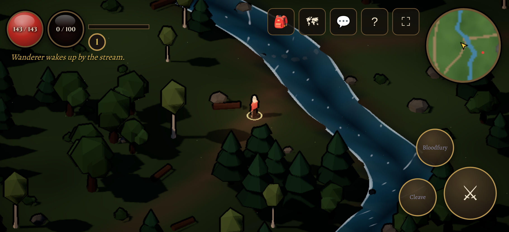
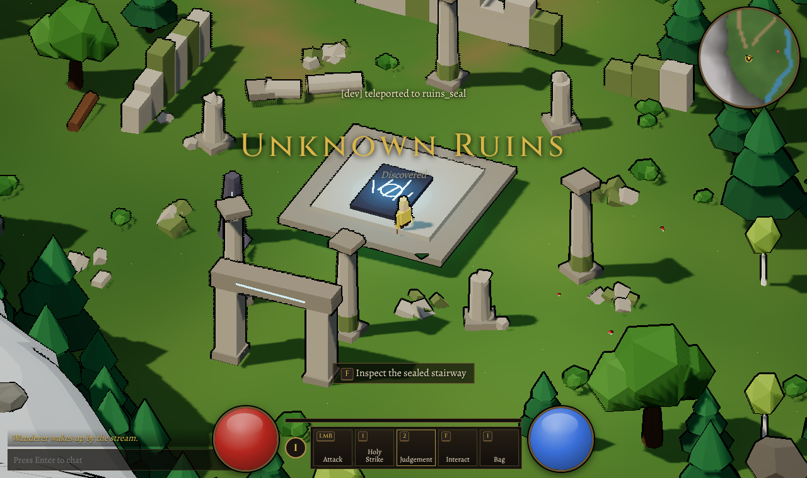
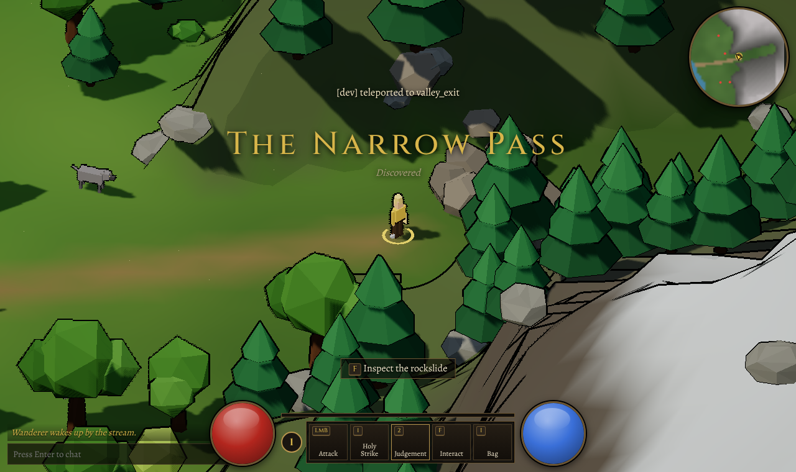
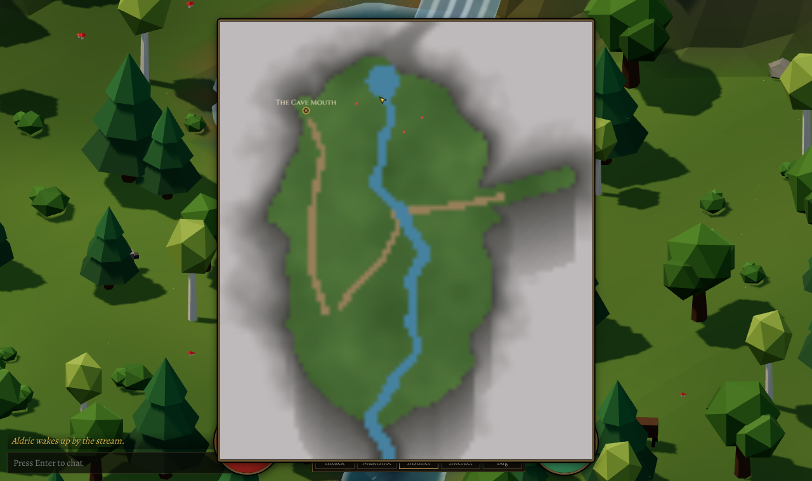

# RPG (working title)

An old-school, third-person **isometric action RPG / dungeon crawler** that runs
in the browser, with **online multiplayer**. You wake up on the bank of a stream
in an unknown forest with almost nothing: tattered clothes, a crude weapon, a
heel of stale bread and an empty waterskin.

> Status: **groundwork**. The engine, networking, 12 classes, combat loop and
> starting forest are in place. Story, quests, loot and dungeons come next.


## Tech stack

| Layer | Choice | Licence | Why |
| --- | --- | --- | --- |
| Rendering | [three.js](https://threejs.org) | MIT | Lightweight, mature WebGL renderer. Full control over the classic isometric look. |
| Multiplayer | [Colyseus](https://colyseus.io) | MIT | Authoritative Node.js game server: rooms, matchmaking, delta-compressed state sync, reconnection, Redis scaling. |
| Client build | [Vite](https://vite.dev) + TypeScript | MIT | Fast dev server, simple production build. |
| Art | Procedural low-poly placeholders + optional **CC0** packs (KayKit, Quaternius, Kenney) | CC0 | Runs with zero downloads; real models drop in via a manifest. See [docs/ASSETS.md](docs/ASSETS.md). |

Alternatives that were considered: Babylon.js (heavier, more built in),
PlayCanvas (engine is MIT but the editor is hosted/proprietary), Phaser (2D
only, would mean sprite-based isometric art), Godot web export (large WASM
download, harder to iterate on web networking).

## Quick start

Requires **Node.js 20+**.

```bash
npm install
npm run dev
```

- Game client: <http://localhost:5173>
- Game server: `ws://localhost:2567` (health check at <http://localhost:2567/health>)

Open the client in two browser windows to see multiplayer. Other people on your
network can join via `http://<your-ip>:5173`.

### Production

```bash
npm run build   # builds client/dist
npm start       # one process serves the game client and the multiplayer server on $PORT (default 2567)
```

Or with Docker:

```bash
docker build -t rpg .
docker run -p 2567:2567 rpg
```

### Dev chat commands

When the server is not running with `NODE_ENV=production`, these chat commands help with testing:

| Command | Effect |
| --- | --- |
| `/tp <place>` | Teleport to `spawn`, `pool`, `ruins_seal`, `cave_thorns`, `valley_exit` or `signpost` |
| `/open <gate>` / `/close <gate>` | Open or seal `valley_exit`, `ruins_seal` or `cave_thorns` for everyone |

### Other scripts

| Command | What it does |
| --- | --- |
| `npm run typecheck` | Type-check all three packages |
| `npm test` | Unit tests for shared data/world/movement |
| `npm run docs:classes` | Regenerate [docs/CLASSES.md](docs/CLASSES.md) from the class data |

## Controls

Mouse and keyboard, an **Xbox controller** (the default glyph layout; any
controller using the browser's standard mapping works) and **touch screens**
are all supported. The on-screen prompts switch to whatever you last used.

| Action | Mouse & keyboard | Xbox controller | Touch |
| --- | --- | --- | --- |
| Move | Left click (hold) / `W A S D` | Left stick (analog: push lightly to walk) | Drag on the left half of the screen |
| Attack | Left click an enemy | `A` (auto-targets, hold to keep fighting) | ⚔ button, or tap an enemy |
| Class ability | Right click / `1` | `X` (aim with right stick, else auto-aim) | Ability button (tap to auto-aim, drag to aim) |
| Subclass ability | `2` | `Y` | Second ability button |
| Interact / inspect | `F` | `B` | ✋ button (appears when something is near) |
| Quick-use food / water | `3` / `4` | D-pad ↑ / ↓ | via the pack |
| Character & pack | `I` | View | 🎒 |
| Map | `M` | Right stick click | 🗺 |
| Zoom | Mouse wheel | `LB` / `RB` | Pinch |
| Help | `H` | Menu | ? |

Menus (character creation, pack) are navigable with the D-pad / stick and `A`;
`Menu` starts the game from character creation, `B` closes panels. Controllers
rumble when you take damage, where the browser supports it.

On phones the game runs in landscape or portrait, and can be added to the home
screen to run full-screen (it ships a web app manifest).



## What's in the groundwork

- **12 classes × 2 subclasses** with their own resource (mana, rage, energy, focus),
  stats, basic attack, class ability and subclass ability. All data-driven:
  [docs/CLASSES.md](docs/CLASSES.md).

  | | | | |
  |---|---|---|---|
  | Warrior (Berserker / Guardian) | Paladin (Crusader / Lightwarden) | Ranger (Beastmaster / Sharpshooter) | Rogue (Assassin / Shadowdancer) |
  | Wizard (Pyromancer / Cryomancer) | Cleric (Lifebinder / Inquisitor) | Necromancer (Bonecaller / Plaguebringer) | Druid (Shapeshifter / Grovekeeper) |
  | Monk (Iron Fist / Windwalker) | Bard (Skald / Trickster) | Warlock (Hexblade / Voidcaller) | Shaman (Stormcaller / Spiritwalker) |

- **Character creation** with name, class and path (subclass).
- **The starting valley**: a small forested valley (~100 m × 160 m) walled in by
  mountains. A waterfall in the north cliffs feeds a pool and a winding stream
  (wading slows you down) that leaves through a gorge in the south. Worn trails
  lead from the clearing where you wake to three places you can't enter yet:
  - **The Narrow Pass** (east): the only way out, buried under a rockslide.
  - **Unknown Ruins** (south-west): a broken colonnade around a stairway sealed by a rune-carved slab.
  - **The Cave Mouth** (north-west): a cave in the cliffs, choked with black thorns.

  Each is a server-side *gate*: sealed for now, with an inspect message, and
  ready for the story to open later (`/open` in dev). Landmarks are announced
  the first time you find them and appear on the minimap.
- **Cel-shaded look**: toon lighting in hard bands and ink outlines from a
  screen-space depth pass.
- **Time-of-day lighting, ready for a day/night cycle**: sun, sky, fog, colour
  grade, your lantern, firefly and landmark glows all come from presets
  (night, dawn, day, dusk) blended by hour in `client/src/scene/Lighting.ts`.
  The game is fixed at mid-morning for now; add `?time=21` to the URL to
  preview night (any hour 0-24 works).
- **Isometric cut-away**: mountains on the camera side of the valley are kept
  low and anything between the camera and your character fades out, so you are
  never hidden.
- **Minimal starting supplies**: class-flavoured crude weapon, tattered clothes,
  stale bread (heal) and an empty waterskin you can fill at the stream (`F`) and
  drink to restore your resource.
- **Server-authoritative multiplayer** (up to 16 per world instance): movement,
  combat, abilities, buffs, enemy AI, XP sharing, levelling, death and respawn.
- **Forest creatures**: grey wolves, tusked boars and thornlings that wander,
  aggro, chase, leash back home and respawn.
- **Classic isometric presentation**: orthographic camera, low-poly art,
  see-through foliage around your hero, health/resource orbs, hotbar with
  cooldowns, floating combat text, nameplates, party frames, chat.



| The Cave Mouth | The Narrow Pass |
| --- | --- |
|  |  |

| Night preview (`?time=21`) | Valley map |
| --- | --- |
|  |  |


## Project layout

```
shared/   game data & rules used by client and server (classes, items, enemies, world gen, movement, protocol)
server/   Colyseus server: ForestRoom (networking) + Game (simulation) + synced schema
client/   Vite + three.js: scene, avatars, effects, input, HUD, character creation
docs/     architecture, class reference, asset sources
```

Read [docs/ARCHITECTURE.md](docs/ARCHITECTURE.md) for how the pieces fit.

## Roadmap

Suggested next steps, roughly in order:

1. **Art pass**: drop in KayKit/Quaternius CC0 packs via the model manifest (manual download for now; see [docs/ASSETS.md](docs/ASSETS.md)).
2. **Persistence**: accounts and saved characters (Colyseus auth + a database such as SQLite/Postgres).
3. **Loot & inventory**: drops, equipment slots, item rarity, vendor.
4. **Abilities 2.0**: status effects (slow, stun, DoT), pets/summons (Beastmaster, Bonecaller), forms (Shapeshifter), talent points per level.
5. **Dungeons**: instanced rooms generated from KayKit dungeon tiles; parties enter together.
6. **Story & quests**: the amnesia hook, NPCs, the first settlement.
7. **Day/night cycle**: advance the hour from server time (`GameClient.setHour`); night spawns, light radius gameplay.
8. **Audio**: ambience (stream, birds), combat SFX, music.
9. **Ops**: Redis presence for multiple server processes, deployment pipeline.
